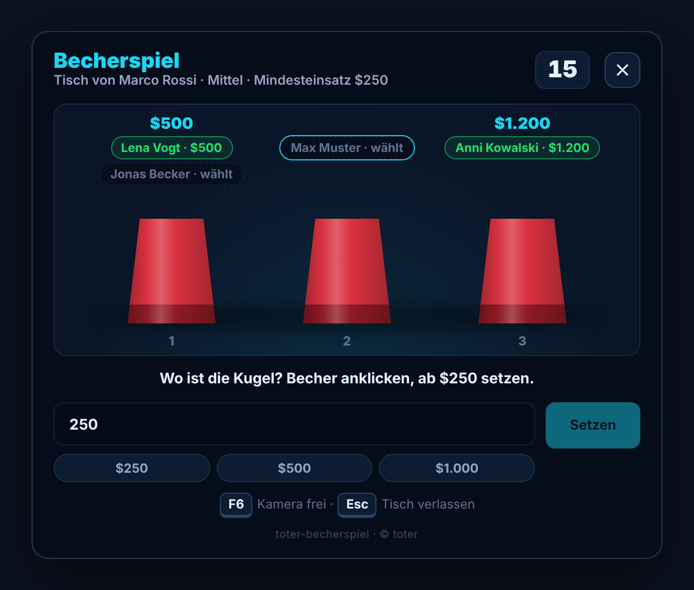
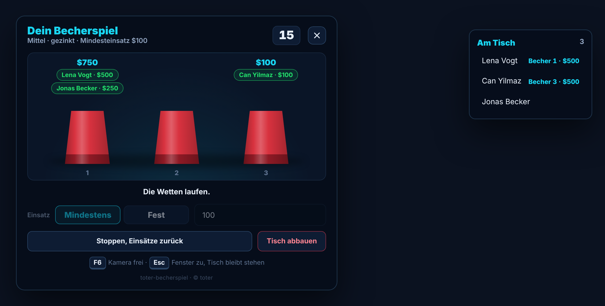
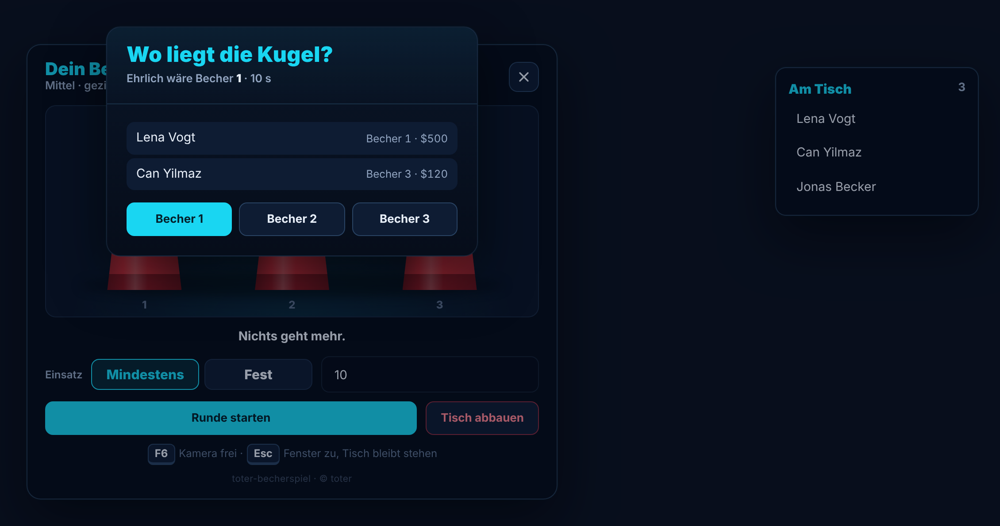
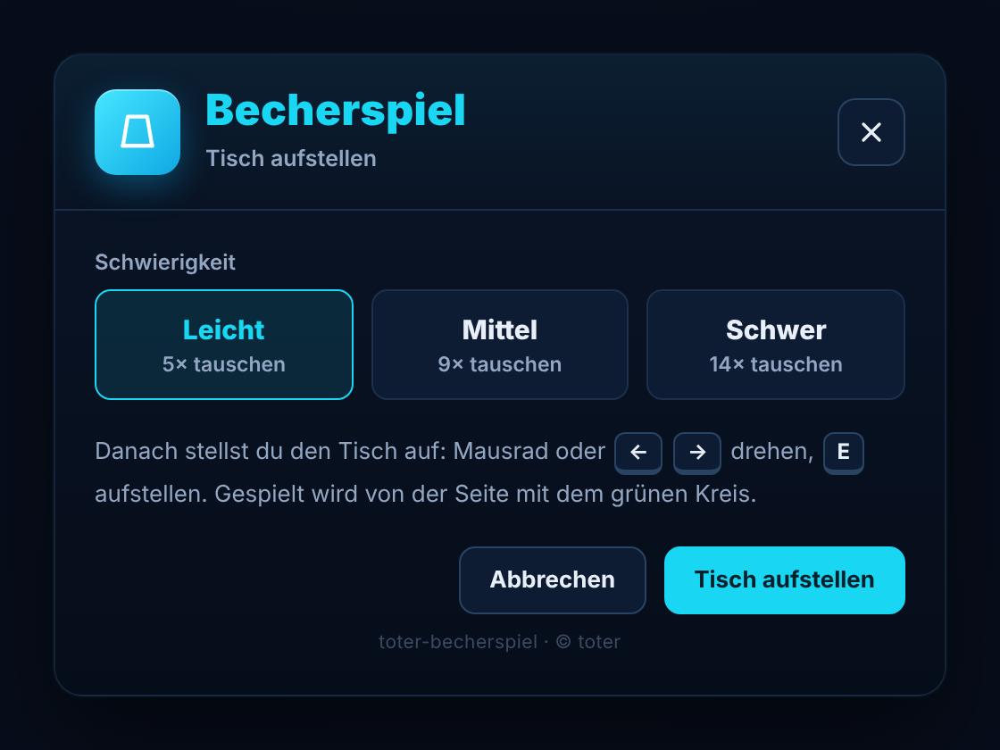
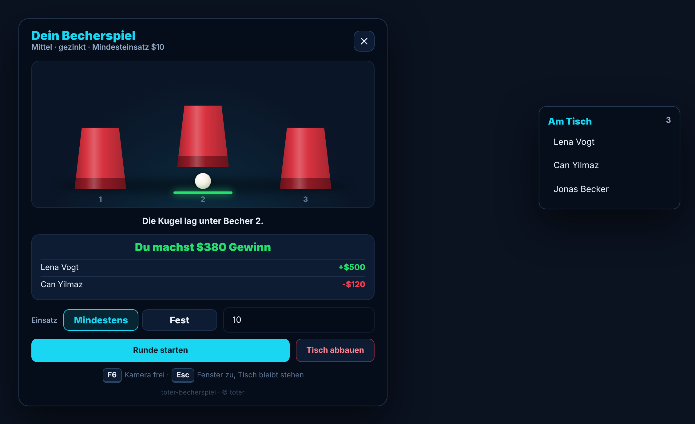

<div align="center">

# toter-becherspiel

**Hütchenspiel für FiveM: Gangs stellen einen Tisch auf, andere setzen Bargeld, der Host entscheidet, wo die Kugel liegt.**




</div>

> **English:** A shell game (three cups, one ball) for FiveM written in C#. A gang member places a table with an item, up to six players bet cash on a cup, and every bet is visible above the cups. The table is rigged: after betting closes, the host has ten seconds to choose where the ball is. All money logic runs on the server. QBCore is the default; everything outside the resource sits in two bridge files, so other frameworks and inventories can be connected. The UI and docs are in German.

## Inhalt

- [Funktionen](#funktionen)
- [Bilder](#bilder)
- [Voraussetzungen](#voraussetzungen)
- [Installation](#installation)
- [Bedienung](#bedienung)
- [Einstellungen](#einstellungen)
- [Anbindung an andere Server](#anbindung-an-andere-server)
- [Selbst bauen](#selbst-bauen)
- [Sicherheit](#sicherheit)
- [Lizenz und Credits](#lizenz-und-credits)

## Funktionen

- **Tisch aufstellen** mit dem Item `becherset`, nur für Gang-Mitglieder (einstellbar, auch nur bestimmte Gangs). Vorschau in der Welt, drehen mit Mausrad oder Pfeiltasten, Becher und Kugel liegen auf der echten Tischplatte
- **Bis zu sechs Mitspieler** pro Tisch, Beitritt per `E` von der Spielseite
- **Drei Schwierigkeiten**: wie oft und wie schnell gemischt wird
- **Einsatz pro Runde**: der Host legt fest oder Mindesteinsatz fest, nach oben offen. Der Betrag steht bei den Spielern schon im Feld
- **Live-Anzeige** über den Bechern: wer gerade wählt (gestrichelt), wer was gesetzt hat (grün), dazu die Summe je Becher
- **Zeit zum Setzen**: höchstens 60 Sekunden, haben alle gesetzt, nur noch 5
- **Gezinkt**: Nach den Wetten wählt der Host in 10 Sekunden den Becher mit der Kugel, die Spieler sehen das nicht
- **Stoppen** ohne Aufdecken, alle Einsätze gehen zurück
- **Freie Kamera** am Tisch mit `F6`
- Keine Datenbank, keine Chat-Befehle

## Bilder

| Host während der Wetten | Becher wählen (gezinkt) |
|---|---|
|  |  |

| Tisch aufstellen | Ergebnis |
|---|---|
|  |  |

## Voraussetzungen

| | |
|---|---|
| Pflicht | FiveM-Server mit OneSync |
| Framework | `qb-core` (Standard). Qbox läuft meist direkt, ESX über die Anschlüsse |
| Inventar | qb-inventory oder kompatibel. ox_inventory über die Anschlüsse |

## Installation

1. Die fertige Version holen, die DLLs sind darin schon gebaut. Entweder als ZIP unter [Releases](https://github.com/toter99/toter-becherspiel/releases) oder per Git im Ordner `resources/`:
   ```bash
   git clone -b release --depth 1 https://github.com/toter99/toter-becherspiel.git
   ```
   Updates holt ihr dann mit `git pull` im Ordner. Wer den Quellcode von `main` nimmt, baut selbst (siehe unten).
2. Den Ordner `toter-becherspiel` nach `resources/` legen und in der `server.cfg` eintragen:
   ```cfg
   ensure qb-core
   ensure toter-becherspiel
   ```
3. `inventar/becherset.png` in den Bilder-Ordner eures Inventars kopieren. Das Item legt die Ressource bei qb-core selbst an. Für andere Inventare steht der Eintrag in `inventar/LIESMICH.txt`.
4. Das Becherset in einen Shop, zu einem Händler oder per Admin (`/giveitem`) verteilen.

## Bedienung

| Was | Wirkung |
|---|---|
| Becherset benutzen | Tisch aufstellen (Gang-Mitglieder) oder den eigenen Tisch wieder öffnen |
| Mausrad, Pfeil links/rechts | Tisch beim Aufstellen drehen |
| `E` | Tisch aufstellen, am Tisch mitspielen (Seite mit dem grünen Kreis) |
| `F6` | zwischen Maus und freier Kamera wechseln (änderbar unter Einstellungen, Tastenbelegung, FiveM) |
| `Esc` | Host: Fenster zu, Tisch bleibt. Spieler: Tisch verlassen |

**Ablauf einer Runde:** Der Host wählt Einsatz-Art und Betrag und startet. Die Kugel wird kurz gezeigt, die Becher werden gemischt, dann wird gesetzt. Danach wählt der Host den Becher, dann wird aufgedeckt. Verlierer zahlen ihren Einsatz an den Host, Gewinner bekommen ihren Einsatz plus den gleichen Betrag vom Host. Reicht das Geld des Hosts nicht, wird nach Einsatzhöhe aufgeteilt.

## Einstellungen

Alles steht in [`Shared/Config.cs`](Shared/Config.cs). Nach Änderungen neu bauen.

| Einstellung | Standard | |
|---|---|---|
| `Konto` | `cash` | Bargeld, `bank` geht auch |
| `EinsatzMin` | `10` | kleinster Einsatz |
| `NurGangsAufstellen`, `NurGangsMitspielen` | `true`, `false` | wer aufstellen und wer setzen darf |
| `Gangs` | leer | nur diese Gangs, leer = alle |
| `WettSekunden`, `AlleGesetztSekunden` | `60`, `5` | Zeit zum Setzen |
| `ImmerGezinkt`, `ZinkenMs` | `true`, `10000` | jeder Tisch gezinkt, Zeit für den Host |
| `MaxSpieler` | `6` | Mitspieler ohne Host |
| `Stufen` | Leicht, Mittel, Schwer | Mischen |
| `Tisch`, `BecherModell`, `KugelModell` | GTA-Props | Aussehen |

## Anbindung an andere Server

Das Spiel ruft keine fremde Ressource direkt auf. Framework, Name, Gang, Geld, Item und Meldungen laufen über wenige Funktionen in `Server/Bridge.cs` und `Client/Bridge.cs`.

In **[ANSCHLUESSE.md](ANSCHLUESSE.md)** steht jede Funktion mit dem, was sie liefern muss, dazu Beispiele für Qbox, ESX, Bargeld als Item, ox_inventory, eigene Gang-Skripte und ox_lib.

Ohne qb-core die Zeile `dependency 'qb-core'` in `fxmanifest.lua` entfernen.

## Selbst bauen

Gebraucht wird das [.NET SDK](https://dotnet.microsoft.com/download) (6 oder neuer). Die FiveM-Pakete kommen über NuGet.

```bash
dotnet build Client/Client.csproj -c Release
dotnet build Server/Server.csproj -c Release
```

Die Ressource lädt `Client/bin/Release/*.net.dll` und `Server/bin/Release/*.net.dll`. GitHub Actions baut bei jedem Push auf `main` und hängt bei einer neuen Version die fertige ZIP an das Release.

| Ordner | Inhalt |
|---|---|
| `Client/` | Aufstellen, Tisch, Becher, Kamera, Anschlüsse |
| `Server/` | Tische, Runden, Wetten, Abrechnung, Anschlüsse |
| `Shared/` | Einstellungen, JSON, Rechnen |
| `html/` | Oberfläche |
| `inventar/` | Item-Bild und Item-Eintrag |

## Sicherheit

- Geld, Gang, Item, Abstand zum Tisch und Wettphase prüft nur der Server
- Der Client schickt nur Becher und Betrag, nie Ergebnisse
- Server-Events sind pro Spieler gedrosselt
- Gewinne werden ohne Überlauf gerechnet
- Andere Spieler erfahren nicht, ob ein Tisch gezinkt ist

Lücken bitte nicht öffentlich als Issue melden, sondern privat über GitHub ([Security Advisory](https://github.com/toter99/toter-becherspiel/security/advisories/new)).

## Mitwirken

Fehler und Ideen gerne als [Issue](https://github.com/toter99/toter-becherspiel/issues), Pull Requests sind willkommen. Bitte den Stil beibehalten: deutsche Namen, wenig Kommentare, fremde Ressourcen nur über die Anschluss-Dateien.

## Lizenz und Credits

[MIT](LICENSE) © 2026 toter

Erstellt von **toter** · [github.com/toter99](https://github.com/toter99)

Wenn ihr die Ressource weitergebt oder umbaut, lasst den Hinweis auf den Ersteller bitte drin.
